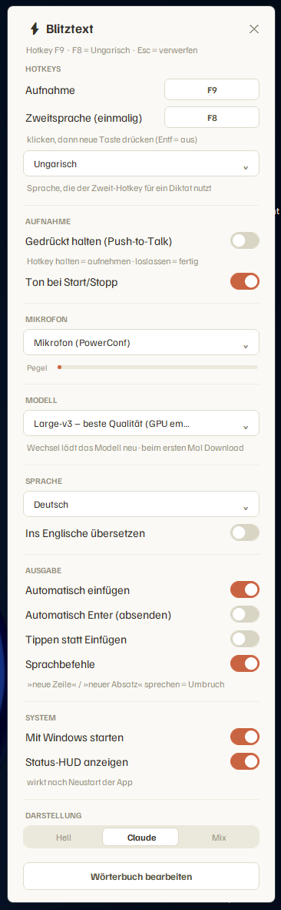

# ⚡ Blitztext-Win

**Sprache zu Text per Tastendruck – komplett lokal, kostenlos, ohne Cloud.**
Taste drücken, sprechen, Taste nochmal drücken – der Text erscheint dort, wo dein Cursor steht
(Word, Browser, WhatsApp, Chat, E-Mail …). Die Erkennung läuft mit
[Whisper](https://github.com/openai/whisper) ([faster-whisper](https://github.com/SYSTRAN/faster-whisper))
auf deinem eigenen PC. Keine Konten, keine API-Keys, keine Daten verlassen den Rechner.

> *English in short:* Local, free push-to-talk dictation for Windows. Hotkey → speak → hotkey → text is
> pasted at your cursor. Runs Whisper on your own PC (NVIDIA GPU optional, CPU works too).
> Choose the model size and hotkeys in the settings window. Setup: install Python 3.10+, run `setup.bat`,
> start with `Blitztext.vbs`. MIT licensed. The interface is available in **German and English**
> (follows your Windows language, switchable in the settings).

Windows-Nachbau der Idee von [blitztext-app](https://github.com/cmagnussen/blitztext-app)
(macOS) von cmagnussen – mit freundlicher Erlaubnis des Autors.

---

## Das brauchst du
- **Windows 10 oder 11**
- **Python 3.10 oder neuer** – [python.org/downloads](https://www.python.org/downloads/), beim Installieren
  **„Add python.exe to PATH“** anhaken
- Ein Mikrofon
- **Optional:** eine NVIDIA-Grafikkarte – damit ist das beste Modell blitzschnell. Ohne läuft es auf der CPU
  (dann ein kleineres Modell nehmen, siehe unten). **AMD Radeon / Intel-Grafik:** siehe
  [Fragen & Antworten](#fragen--antworten) – läuft auf der CPU.
- Platz: ca. 0,6 GB für die Programmpakete (mit NVIDIA-Karte ca. 2 GB) + 0,1–3 GB für das Sprachmodell (je nach Wahl)

## Installation
1. Dieses Repo herunterladen (grüner Button **Code → Download ZIP**, entpacken) oder mit Git klonen.
2. **`setup.bat`** doppelklicken. Das Skript prüft Python, erkennt selbst, ob du eine NVIDIA-Karte hast
   (und installiert dann die GPU-Beschleunigung mit), legt eine eigene Python-Umgebung (`.venv`) an und lädt alle
   Pakete. Das dauert einige Minuten. Am Ende fragt es, ob Blitztext **mit Windows starten** soll und ob es
   **gleich losgehen** darf.
3. Später startest du mit **`Blitztext.vbs`** (läuft unsichtbar im Hintergrund) oder mit **`start_test.bat`**
   (mit Log-Fenster, gut zum Ausprobieren).
4. Beim allerersten Start lädt Blitztext einmalig das Sprachmodell herunter – **den Fortschritt siehst du in
   Prozent unten am Bildschirm** – und öffnet danach die Einstellungen. Solange das Modell lädt, ist das Tray-Icon
   (unten rechts in der Taskleiste) **grau**.

**Beim ersten Start wählt Blitztext selbst das passende Modell:**
mit NVIDIA-Grafikkarte `large-v3` (beste Qualität), sonst `small` auf der CPU. Ändern kannst du das jederzeit
im Einstellungsfenster.

## So benutzt du es
1. **Hotkey drücken** (Standard `F9`) → Aufnahme startet (Icon **rot**)
2. Sprechen
3. **Hotkey nochmal drücken** → Text wird erkannt (Icon **orange**) und **dort eingefügt, wo dein Cursor steht**
4. Icon wieder **blau** = bereit

Icon-Farben: grau = Modell lädt · blau = bereit · rot = nimmt auf · orange = verarbeitet.

- **Esc** während der Aufnahme = verwerfen
- **Push-to-Talk:** Hotkey gedrückt halten = aufnehmen, loslassen = fertig
- **Zweit-Hotkey (Standard `F8`):** diktiert *einmalig* in einer anderen Sprache (Standard Englisch), ohne die
  Hauptsprache umzustellen – praktisch, wenn du zwischen zwei Sprachen wechselst
- **Sprachbefehle:** „neue Zeile“ / „neuer Absatz“ sprechen = echter Umbruch (auch „new line“ / „új sor“)
- **Verlauf:** die letzten 10 Diktate stehen im Tray-Menü, Klick = in die Zwischenablage
- **Wörterbuch:** eigene Namen und Fachbegriffe, die Whisper sonst falsch schreibt
- **App-Profile:** je nach aktivem Fenster andere Einstellungen – z. B. in WhatsApp automatisch Enter drücken
  (siehe `app_profiles` unten)

## Einstellungsfenster
**Doppelklick auf das Tray-Icon** öffnet die Einstellungen. Alles wirkt sofort, ohne Neustart:

| Bereich | Was du einstellen kannst |
|---|---|
| **Hotkeys** | Pille anklicken, dann die neue Taste oder Kombi drücken (z. B. `Strg+Alt+D`). `Entf` schaltet den Zweit-Hotkey aus, `Esc` bricht ab. |
| **Zweitsprache** | Sprache des Zweit-Hotkeys (17 Sprachen zur Auswahl) |
| **Aufnahme** | Push-to-Talk, Ton bei Start/Stopp |
| **Mikrofon** | Gerät wählen, mit Live-Pegelanzeige |
| **Modell** | Größe des Whisper-Modells (siehe unten) |
| **Sprache** | Diktiersprache oder Automatik, optional direkt ins Englische übersetzen |
| **Ausgabe** | Automatisch einfügen, Enter, Tippen statt Einfügen, Sprachbefehle |
| **System** | Mit Windows starten, Status-Anzeige (HUD), Update-Hinweis ein/aus |
| **Darstellung** | Drei Stile (Mix, Claude, Hell) und Oberflächen-Sprache (Automatisch, Deutsch, English) |

Das Fenster scrollt mit dem Mausrad, falls dein Bildschirm klein ist.

## Welches Modell?
Größer = genauer, aber langsamer und mehr Speicher. Im Einstellungsfenster unter **Modell** wählbar –
beim ersten Mal wird das Modell einmalig heruntergeladen.

| Modell | Download | Gut für |
|---|---|---|
| `tiny` | ca. 75 MB | sehr schwache PCs, grobe Erkennung |
| `base` | ca. 140 MB | schwache PCs |
| `small` | ca. 460 MB | **Standard ohne Grafikkarte** – schnell und brauchbar |
| `medium` | ca. 1,5 GB | gute Qualität, langsam auf CPU |
| `large-v3-turbo` | ca. 1,6 GB | fast so gut wie Large, deutlich schneller |
| `large-v3` | ca. 3 GB | **beste Qualität – mit NVIDIA-Grafikkarte empfohlen** |

Faustregel: **Mit NVIDIA-Karte → `large-v3`. Ohne → `small`** (wenn dir das zu ungenau ist: `medium` oder
`large-v3-turbo` ausprobieren, falls dein PC es schafft).

## Wörterbuch
Tray-Menü bzw. Einstellungsfenster → **Wörterbuch bearbeiten**. Ein Begriff pro Zeile (Namen, Fachwörter,
Abkürzungen). Wirkt sofort beim nächsten Diktat. Nicht übertreiben: ab ca. 50 Begriffen lässt der Effekt nach.

## Mikrofon
Im Einstellungsfenster oder per Rechtsklick auf das Tray-Icon → **Mikrofon**. Der Gerätename wird gespeichert –
auch wenn das Gerät (z. B. Headset) gerade nicht verbunden ist; sobald es wieder da ist, wird es genutzt,
sonst greift der System-Standard.
> Tipp: Virtuelle Geräte wie „SteelSeries Sonar – Microphone“ liefern oft Stille. Lieber dein echtes Mikro wählen.

## Update-Hinweis
Blitztext fragt beim Start im Hintergrund bei GitHub, ob es eine neue Version gibt, und zeigt dann im
Tray-Menü einen Eintrag „Update verfügbar“ (Klick öffnet die Release-Seite). Es wird **nichts automatisch
installiert**, und es werden keine Daten von dir gesendet – nur die übliche Web-Anfrage (wie beim Öffnen einer Webseite).
Abschalten: Einstellungsfenster → System → „Nach Updates suchen“ oder `"update_check": false` in `config.json`.

## Autostart
Einstellungsfenster → **Mit Windows starten** (legt eine kleine Starter-Datei im Autostart-Ordner an,
Haken entfernen = wieder weg).

## Erweiterte Einstellungen (`config.json`)
Wird beim ersten Start angelegt. Alles Wichtige geht im Einstellungsfenster; diese Datei ist für den Rest.
Nach Änderungen an der Datei die App neu starten (Tray-Menü → **Neu starten**).

| Einstellung | Bedeutung |
|---|---|
| `hotkey` / `hotkey_second` | Tasten, z. B. `<f9>`, `<ctrl>+<alt>+d` |
| `second_language` | Sprache des Zweit-Hotkeys, Kürzel wie `en`, `hu`, `fr` |
| `model` | `tiny`, `base`, `small`, `medium`, `large-v3-turbo`, `large-v3` |
| `device` / `compute_type` | `cuda` + `float16` (GPU) oder `cpu` + `int8` |
| `language` | `de`, `en` … fest, oder `""` für automatische Erkennung |
| `translate_to_english` | `true` = Gesprochenes wird ins Englische übersetzt |
| `paste` / `auto_enter` / `type_instead_of_paste` | Einfügen, Enter danach, Tippen statt Strg+V |
| `initial_prompt` | zusätzlicher Kontext für die Erkennung (neben dem Wörterbuch) |
| `max_seconds` | Aufnahme-Limit in Sekunden (`0` = aus, Standard 300) |
| `app_profiles` | Fenstertitel-Schnipsel → Überschreibungen, z. B. `"whatsapp": {"auto_enter": true}` |
| `ui_language` | Oberfläche: `auto` (Windows-Sprache), `de` oder `en` |
| `update_check` | `false` = keine Update-Abfrage bei GitHub |
| `spielmodus_pfad` | Optional, nur für Fortgeschrittene: Ordner mit einem eigenen `spielmodus.py`, das bei laufendem Spiel auf ein sparsames Modell wechselt |

## Probleme?
- **Protokoll:** Blitztext schreibt alles in `blitztext.log` (Tray-Menü → „Protokoll öffnen“), auch wenn es
  unsichtbar läuft – und auch harte Abstürze. Bei einer Fehlermeldung (Issue) bitte die letzten Zeilen anhängen.
- **Kein Text kommt an / Icon bleibt grau:** Beim ersten Start lädt das Modell erst herunter (Internet nötig,
  einmalig, Fortschritt siehst du am Bildschirm). Mit `start_test.bat` siehst du im Fenster, was los ist.
- **Läuft auf der CPU, obwohl ich eine NVIDIA-Karte habe:** Aktuellen NVIDIA-Treiber installieren (`nvidia-smi`
  muss in der Eingabeaufforderung funktionieren) und `setup.bat` nochmal ausführen.
- **Text im Fenster wirkt unscharf (Windows-Skalierung 125 %/150 %):** Blitztext schaltet dafür das scharfe
  Zeichnen ein (Windows 10 ab Version 1809). Falls es bei dir trotzdem unscharf ist, bitte ein Issue aufmachen.
- **Zu langsam:** ein kleineres Modell wählen (siehe oben).
- **Nur Stille aufgenommen:** anderes Mikrofon im Einstellungsfenster wählen, der Pegelbalken muss ausschlagen.
- **Text landet nicht im Zielprogramm:** „Tippen statt Einfügen“ einschalten.
- **Nachsehen, ob die Grafikkarte funktioniert:** `.venv\Scripts\python.exe test_gpu.py`

## Fragen & Antworten
**Geht das auch mit einer AMD Radeon oder Intel-Grafik?**
Ja, aber **nur über die CPU**. Die GPU-Beschleunigung gibt es aktuell nur für NVIDIA (CUDA), weil die verwendete
Erkennungs-Engine (CTranslate2 / faster-whisper) unter Windows keine AMD-Karten ansteuern kann. Mit einer Radeon
erkennt Blitztext das selbst und startet mit dem Modell `small` auf der CPU – das ist für normales Diktieren
brauchbar. Wenn dein Prozessor kräftig ist, kannst du `medium` oder `large-v3-turbo` probieren.
Ein Weg über Vulkan (z. B. mit whisper.cpp) wäre technisch möglich, ist aber ein größerer Umbau – wenn Bedarf da
ist, schreib bitte ein [Issue](../../issues).

**Blitztext hängt oder verhält sich komisch – was tun?**
Tray-Icon rechtsklicken → **Neu starten** (oder im Einstellungsfenster unten den Knopf **Neu starten**).
Das beendet Blitztext und startet es sofort wieder – praktisch auch nach Änderungen an `config.json`.

## Eine `.exe` zum Doppelklicken?
Aktuell läuft Blitztext über Python (`setup.bat`). Wenn du dir eine fertige `.exe` ohne Python-Installation
wünschst, **schreib bitte ein [Issue](../../issues)** – bei genug Bedarf bauen wir sie.

## Hinweis
Kleines Hobbyprojekt, ohne Garantie („as is“). Support und Updates nach Zeit und Lust – Issues und Pull Requests
sind willkommen. Die Texterkennung kann Fehler machen; wichtige Texte bitte kurz gegenlesen.

## Technik und Lizenzen
- Blitztext für Windows steht unter der **MIT-Lizenz** (siehe [LICENSE](LICENSE)) – du darfst es frei nutzen,
  ändern und weitergeben.
- Idee: [blitztext-app](https://github.com/cmagnussen/blitztext-app) von cmagnussen (MIT).
- Spracherkennung: [Whisper](https://github.com/openai/whisper) von OpenAI (MIT) über
  [faster-whisper](https://github.com/SYSTRAN/faster-whisper) (MIT) / CTranslate2.
- Bibliotheken: `sounddevice`, `numpy`, `pynput` (LGPL), `pyperclip`, `pystray` (LGPL), `pillow`.
  Für NVIDIA-Karten werden die Pakete `nvidia-cublas-cu12` und `nvidia-cudnn-cu12` von NVIDIA per `pip` geladen
  (NVIDIA-Lizenzbedingungen, nicht Teil dieses Repos).
- Schriften im Einstellungsfenster: **Lora** und **Familjen Grotesk**, beide unter der SIL Open Font License 1.1
  ([fonts/LICENSE-OFL.txt](fonts/LICENSE-OFL.txt)).
